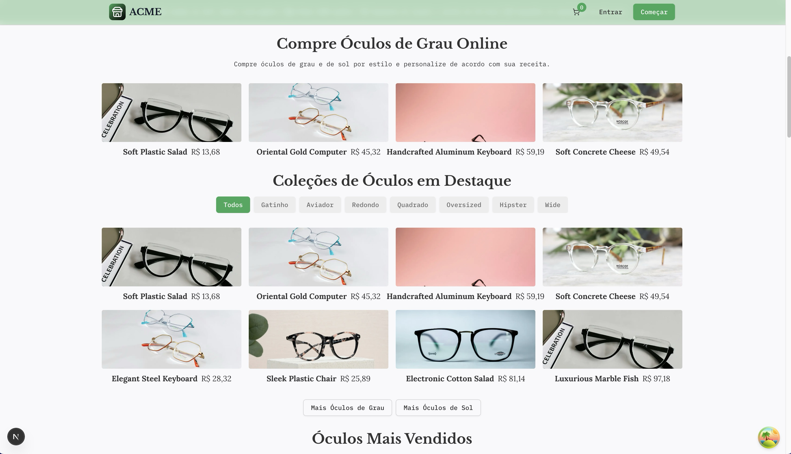
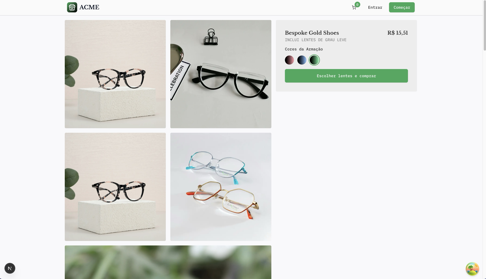
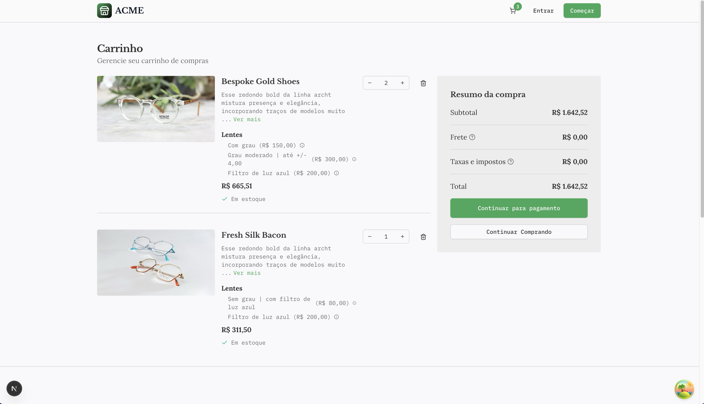
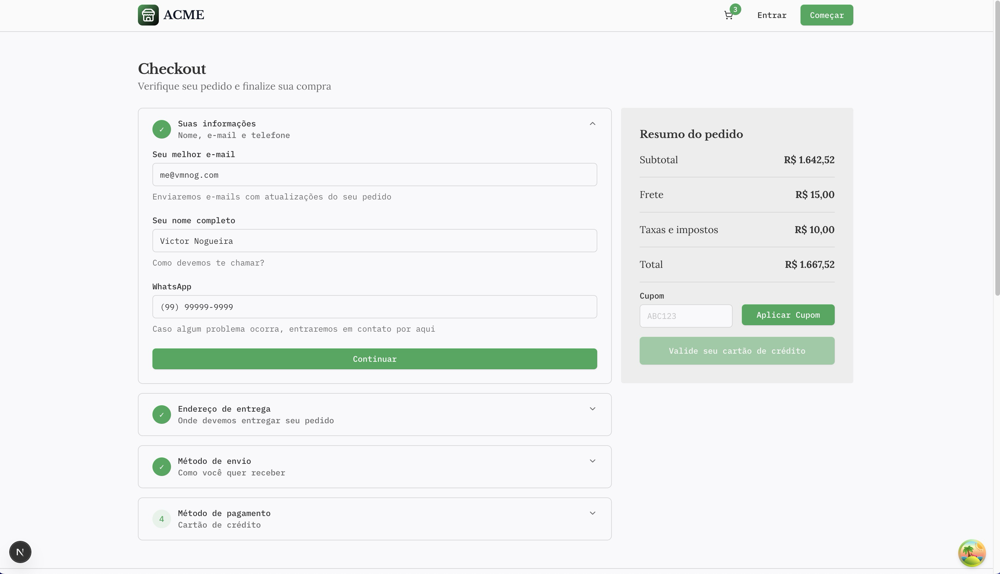
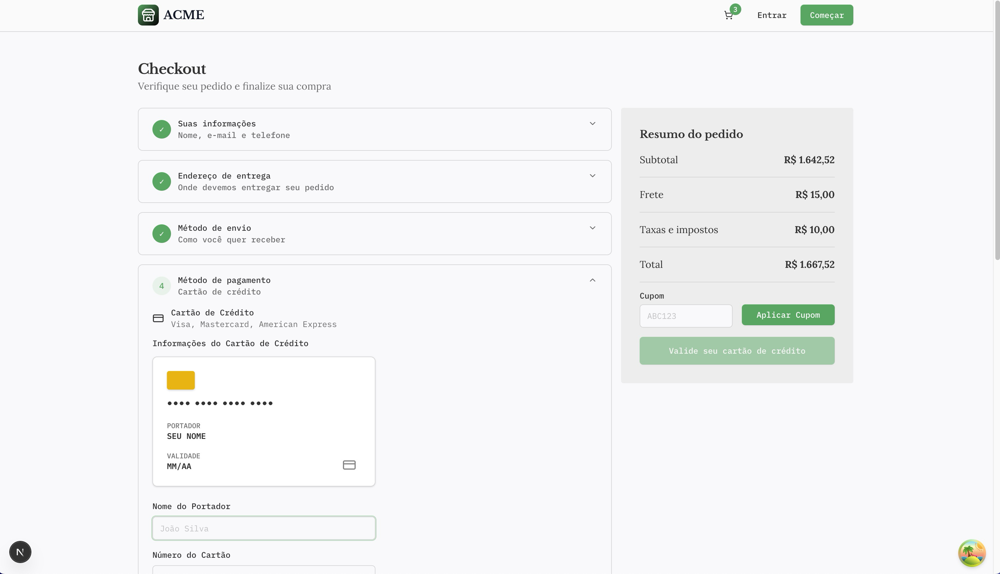

# ACME Eyewear Store

A modern, full-stack e-commerce platform for eyewear built with Next.js 15, featuring a customer storefront, checkout flow with Stripe payments, and an admin panel.


## Features

### Customer Storefront

- **Product Catalog** - Browse eyewear with images, descriptions, and pricing
- **Product Details** - View detailed product information with multiple images
- **Lens Options** - Configure glasses with customizable lens options (prescription, filters, etc.)
- **Shopping Cart** - Persistent cart with quantity management
- **Guest Checkout** - Complete purchases without creating an account
- **Order History** - View past orders and track delivery status





### Authentication

- **Email/Password** - Traditional authentication
- **Google OAuth** - Sign in with Google
- **Magic Links** - Passwordless authentication via email
- **Password Recovery** - Secure password reset flow
- **Session Management** - Secure sessions with automatic expiration

### Checkout & Payments

- **Multi-step Checkout** - Guided checkout with accordion steps
- **Address Management** - Save and reuse shipping addresses
- **Stripe Integration** - Secure payment processing
- **Coupon System** - Apply discount codes with various rules
- **Order Confirmation** - Email notifications on successful orders




### Prescription Management

- **Prescription Upload** - Upload prescription images/PDFs
- **Status Tracking** - Track prescription status per product
- **Automated Reminders** - Email reminders for pending prescriptions

### Admin Panel

- **Dashboard** - Overview of store performance
- **Order Management** - View and manage customer orders
- **Product Management** - CRUD operations for products
- **Customer Management** - View and manage customers
- **Category Management** - Organize products into categories

<!-- TODO: Add admin screenshots -->
<!--  -->
<!--  -->
<!--  -->

### Email System

- **Transactional Emails** - Beautiful email templates with react-email
- **Payment Confirmation** - Order details and receipt
- **Order Updates** - Shipping and delivery notifications
- **Prescription Reminders** - Automated follow-ups

## Tech Stack

| Category | Technology |
|----------|------------|
| Framework | [Next.js 15](https://nextjs.org/) with App Router |
| Language | [TypeScript](https://www.typescriptlang.org/) |
| Database | [PostgreSQL](https://www.postgresql.org/) via [Neon](https://neon.tech/) |
| ORM | [Drizzle ORM](https://orm.drizzle.team/) |
| Authentication | [Better Auth](https://www.better-auth.com/) |
| Payments | [Stripe](https://stripe.com/) |
| Styling | [Tailwind CSS 4](https://tailwindcss.com/) |
| UI Components | [Radix UI](https://www.radix-ui.com/) + [shadcn/ui](https://ui.shadcn.com/) |
| Forms | [React Hook Form](https://react-hook-form.com/) + [Zod](https://zod.dev/) |
| State Management | [Zustand](https://zustand-demo.pmnd.rs/) + [TanStack Query](https://tanstack.com/query) |
| Email | [Resend](https://resend.com/) + [React Email](https://react.email/) |
| File Storage | [Vercel Blob](https://vercel.com/docs/storage/vercel-blob) |
| Linting | [Biome](https://biomejs.dev/) |

## Getting Started

### Prerequisites

- [Node.js](https://nodejs.org/) 18.x or later
- [pnpm](https://pnpm.io/) 8.x or later
- [PostgreSQL](https://www.postgresql.org/) database (or [Neon](https://neon.tech/) account)
- [Stripe](https://stripe.com/) account
- [Resend](https://resend.com/) account (for emails)
- [Vercel Blob](https://vercel.com/docs/storage/vercel-blob) (for file uploads)

### Installation

1. **Clone the repository**

   ```bash
   git clone https://github.com/vmnog/nextjs-stripe-store.git
   cd nextjs-stripe-store
   ```

2. **Install dependencies**

   ```bash
   pnpm install
   ```

3. **Set up environment variables**

   Copy the example environment file and fill in your values:

   ```bash
   cp .env.example .env.local
   ```

   Required environment variables:

   ```env
   # App
   NODE_ENV=development
   WEB_URL=http://localhost:3000
   NEXT_PUBLIC_WEB_URL=http://localhost:3000

   # Database (Neon PostgreSQL)
   DATABASE_URL=postgresql://...

   # Authentication (Better Auth)
   BETTER_AUTH_SECRET=your-secret-key
   BETTER_AUTH_URL=http://localhost:3000

   # Google OAuth
   GOOGLE_CLIENT_ID=your-google-client-id
   GOOGLE_CLIENT_SECRET=your-google-client-secret

   # Stripe
   STRIPE_SECRET_KEY=sk_test_...
   NEXT_PUBLIC_STRIPE_PUBLIC_KEY=pk_test_...
   STRIPE_WEBHOOK_SECRET=whsec_...

   # Resend (Email)
   RESEND_API_KEY=re_...

   # Vercel Blob (File Storage)
   BLOB_READ_WRITE_TOKEN=vercel_blob_...

   # Optional
   CONTACT_EMAIL=contato@yourdomain.com
   ```

4. **Set up the database**

   Push the schema to your database:

   ```bash
   pnpm db:push
   ```

   Seed the database with sample data:

   ```bash
   pnpm db:seed
   ```

5. **Start the development server**

   ```bash
   pnpm dev
   ```

   Open [http://localhost:3000](http://localhost:3000) in your browser.

### Stripe Webhook (Local Development)

To test Stripe webhooks locally, run in a separate terminal:

```bash
pnpm stripe
```

This starts the Stripe CLI listener and forwards events to your local server.

> **Note:** The webhook secret changes each time you restart the Stripe CLI. Update `STRIPE_WEBHOOK_SECRET` in your `.env.local` if needed.

### Email Preview

To preview email templates during development:

```bash
pnpm email
```

Open [http://localhost:3001](http://localhost:3001) to see all email templates.

## Available Scripts

| Command | Description |
|---------|-------------|
| `pnpm dev` | Start development server with Turbopack |
| `pnpm build` | Create production build |
| `pnpm start` | Start production server |
| `pnpm lint` | Run Biome linter |
| `pnpm lint:fix` | Auto-fix linting issues |
| `pnpm db:push` | Push schema changes to database |
| `pnpm db:generate` | Generate database migrations |
| `pnpm db:studio` | Open Drizzle Studio GUI |
| `pnpm db:seed` | Seed database with test data |
| `pnpm db:reset` | Drop all data, push schema, and re-seed |
| `pnpm stripe` | Start Stripe webhook listener |
| `pnpm email` | Preview email templates |

## Project Structure

```
├── emails/                 # React Email templates
├── public/                 # Static assets
├── scripts/                # Database scripts (seed, reset)
├── src/
│   ├── app/
│   │   ├── (private)/      # Authenticated routes
│   │   │   ├── admin/      # Admin panel
│   │   │   └── minha-conta/ # Customer account
│   │   ├── (public)/       # Public routes
│   │   │   ├── (auth)/     # Sign in, sign up, password reset
│   │   │   ├── (customer)/ # Cart, checkout, orders
│   │   │   └── (home)/     # Product listing, storefront
│   │   └── api/            # API routes
│   ├── components/         # Reusable UI components
│   ├── constants/          # App constants
│   ├── hooks/              # Custom React hooks
│   ├── http/               # API client (queries & mutations)
│   ├── lib/                # Utilities, database, auth
│   └── stores/             # Zustand stores
├── CLAUDE.md               # AI assistant instructions
├── FUNCIONALIDADES.md      # Feature inventory (Portuguese)
└── ROADMAP_JANEIRO_2026.md # Launch roadmap (Portuguese)
```

## Roadmap & Planning

This project includes detailed planning documentation:

- **[FUNCIONALIDADES.md](./FUNCIONALIDADES.md)** - Complete feature inventory with implementation status (checkboxes for what's done vs. pending)
- **[ROADMAP_JANEIRO_2026.md](./ROADMAP_JANEIRO_2026.md)** - Launch roadmap with prioritized tasks and time estimates

> **Note:** These documents are in Portuguese as they were created for a Brazilian client project.

### Key Pending Features

- PIX and Boleto payment methods
- Product search and filters
- Affiliate/referral system
- Virtual try-on with AI (Phase 2)
- Dynamic shipping calculation

## Contributing

Contributions are welcome! Please feel free to submit a Pull Request.

1. Fork the repository
2. Create your feature branch (`git checkout -b feature/amazing-feature`)
3. Commit your changes (`git commit -m 'Add some amazing feature'`)
4. Push to the branch (`git push origin feature/amazing-feature`)
5. Open a Pull Request

## License

This project is licensed under the MIT License - see the [LICENSE](LICENSE) file for details.

## Acknowledgments

- [shadcn/ui](https://ui.shadcn.com/) for the beautiful UI components
- [Vercel](https://vercel.com/) for hosting and infrastructure
- [Stripe](https://stripe.com/) for payment processing
- [Neon](https://neon.tech/) for serverless PostgreSQL
